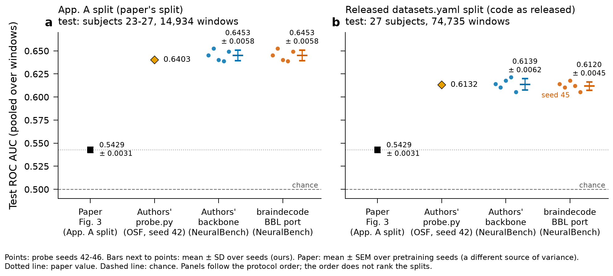

# BBL replication evidence (9 November 2026)

Figure for https://github.com/braindecode/braindecode/pull/1553. Aggregate results and figure inputs only: no MEG recordings, model weights or run logs.

- `bbl_replication.png` / `.svg` / `.pdf`: the figure (same content in three formats). One panel per split (paper App. A split; released `datasets.yaml` split).
- `figure_values.json`: the plotted values and checks.
- `numbers.json`: every number quoted in the PR section and plotted in the figure, mapped to its source file and key.

File fields in the JSON files are relative labels for result files that are not part of this folder. In `numbers.json`, the absolute `base` directory was rewritten to the label `replication/bbl`, so its SHA256 differs from the original; no values were changed. `figure_values.json` is unchanged. Protocol and deviations are in the PR description.
