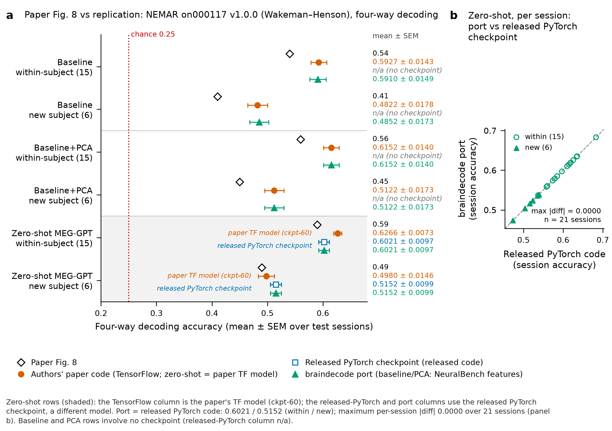

# MEG-GPT replication evidence (9 November 2026)

Figure for https://github.com/braindecode/braindecode/pull/1555. Aggregate results and figure inputs only: no MEG recordings, model weights or run logs.

- `meggpt_replication.png` / `.svg` / `.pdf`: the figure (same content in three formats).
- `caption.md`: figure caption.
- `numbers.json`: every plotted value with its source file and key.
- `paper_values.json`: paper values (Huang et al., MEG-GPT, Imaging Neuroscience 2026, https://doi.org/10.1162/IMAG.a.1301, Fig. 8 / Section 3.5).

Source-file fields in the JSON files are relative labels (`replication/...`) for result files that are not part of this folder. In the copies here, absolute working-directory paths were rewritten to these labels, so their SHA256 differs from the originals (and from `paper_values_sha256` inside `numbers.json`); no values were changed. Protocol, scope and caveats are in the PR description.
