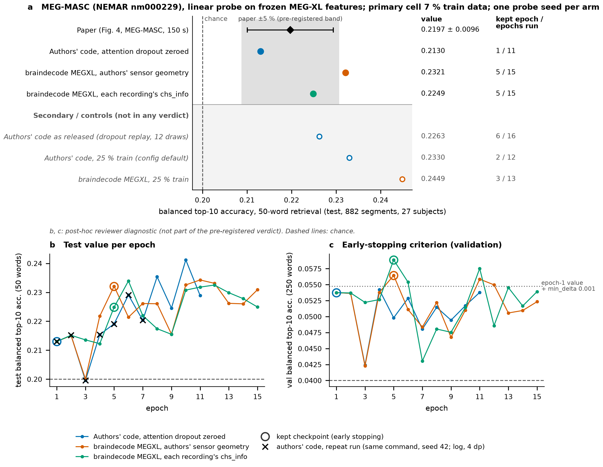

# MEG-XL replication evidence (9 November 2026)

Figure for https://github.com/braindecode/braindecode/pull/1554. Aggregate results and figure inputs only: no MEG recordings, features, model weights or run logs.

- `megxl_replication.png` / `.svg` / `.pdf`: the figure (same content in three formats).
- `numbers.json`: every plotted value with its source file and key, plus SHA256 of the plotting inputs.

Paper: MEG-XL, https://arxiv.org/abs/2602.02494 v2, Fig. 4 (MEG-MASC, 150 s context). Source-file fields in `numbers.json` are relative labels (`replication/...`) for result files that are not part of this folder. In the copy here, absolute working-directory paths were rewritten to these labels, so its SHA256 differs from the original; no values were changed. Protocol, verdicts and deviations are in the PR description.
