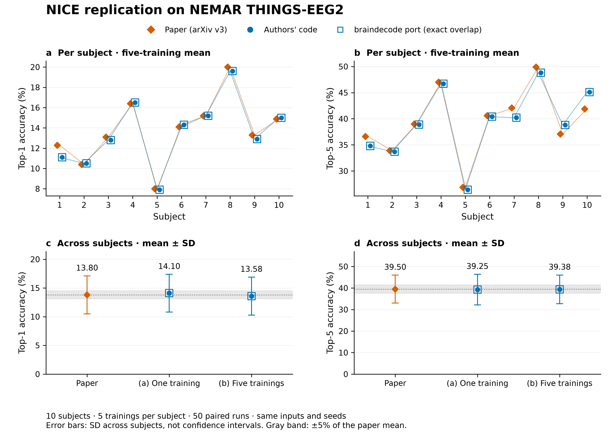

# NICE replication evidence — 8 November 2026

Figure for braindecode/braindecode#1556. This branch contains public aggregate accuracy results and plotting code only; no EEG recordings, stimuli, model weights, private-repository links, or private run logs.

- `results.csv`: 50 subject × training pairs (10 subjects, five trainings), authors' code and braindecode port accuracies in percent. Every pair has equal top-1/top-5 accuracies. `nemar-main` is aggregation (a); all five tags produce aggregation (b), averaging trainings per subject first.
- `paper_targets.json`: targets from Song et al., *Decoding Natural Images from EEG for Object Recognition*, arXiv:2308.13234 v3, Tables 2–3. The paper reports mean top-1 13.8; the rounded subject values average 13.77. The figure uses the reported mean.
- `plot.py`: reads those two files; produces PNG (300 DPI), SVG and PDF, plus `numbers.json`. Requires Python, matplotlib. Run `python plot.py`.
- `numbers.json`: plotted values and the SHA256 of `results.csv`.

## Reading the figure

Panels a–b show per-subject five-training means. Circles (authors' code) and hollow squares (port) overlap exactly. Paper targets use orange diamonds. Panels c–d show the paper mean and both replication aggregations, with **SD across subjects**, not uncertainty in a mean. The gray interval is ±5% relative to the paper's mean; it is a prespecified replication tolerance, **not a confidence interval**. Connecting lines in panels a–b only guide the eye across subject IDs.

## Protocol and scope

NEMAR nm000232 v1.1.1 (THINGS-EEG2); 200-way subject-dependent zero-shot classification. Both arms use identical preprocessed arrays, splits, initial weights, batch order and seed chain. Authors' code: NICE-EEG a7709d81. Port: braindecode 04d85efe (`nice.py` unchanged at PR head 7f2f897c). Default Adam lr 2e-4, betas (0.5, 0.999), batch 1000, 200 epochs, released CLIP ViT-L/14 features. CPU float32; global NumPy seeds 2023–2027 fixed before completed runs. This tests the encoder/projector (`NICE(n_outputs=0)`), not its classification head.

As in the released training script, testing uses epoch-200 weights: the best-validation state-dict reload onto the DataParallel wrapper with `strict=False` loads no weights. Results reproduce the code as run, including that behavior. Targets were independently checked against arXiv v3, not the proceedings PDF. The full training recipe remains private and is not linked here.
